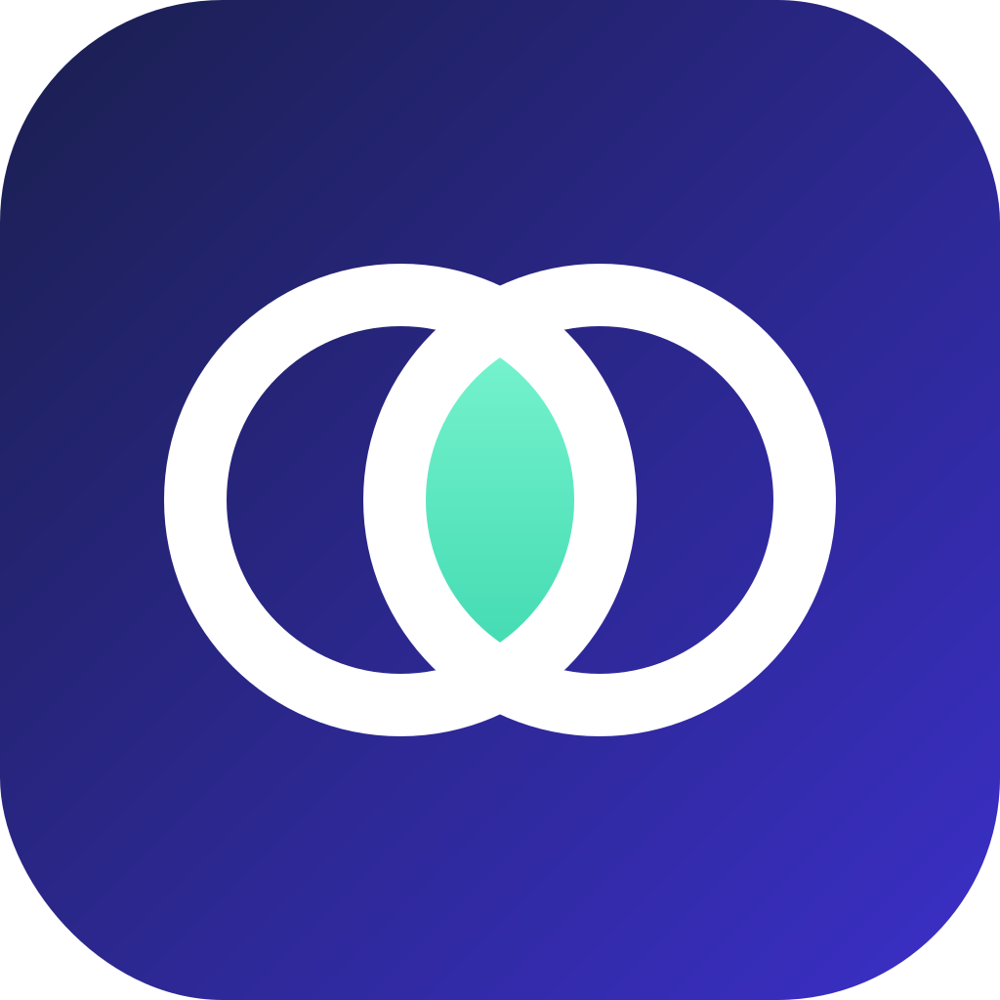
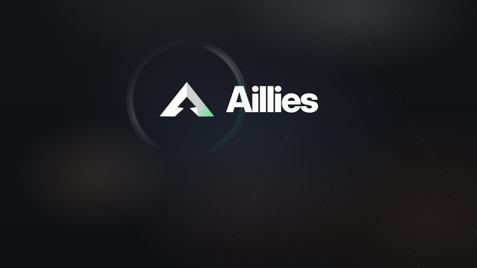
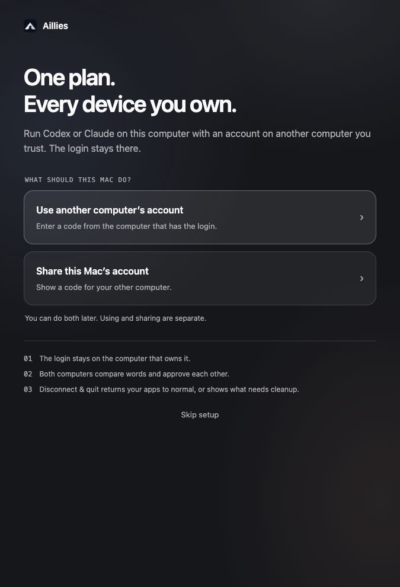
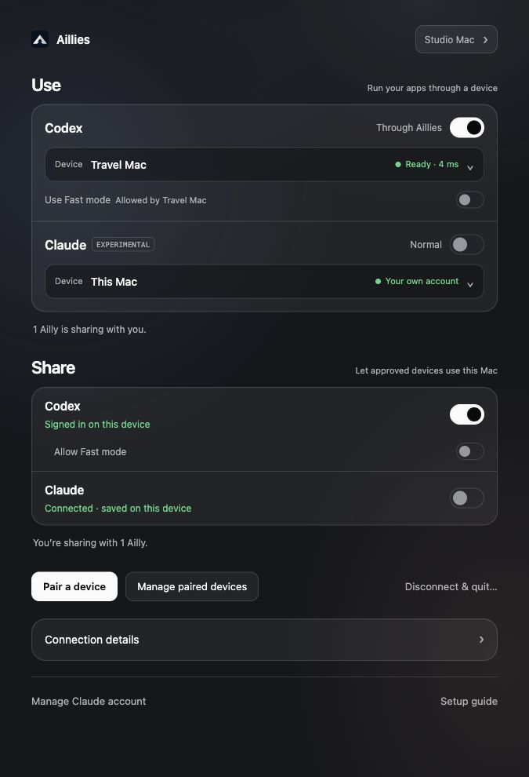
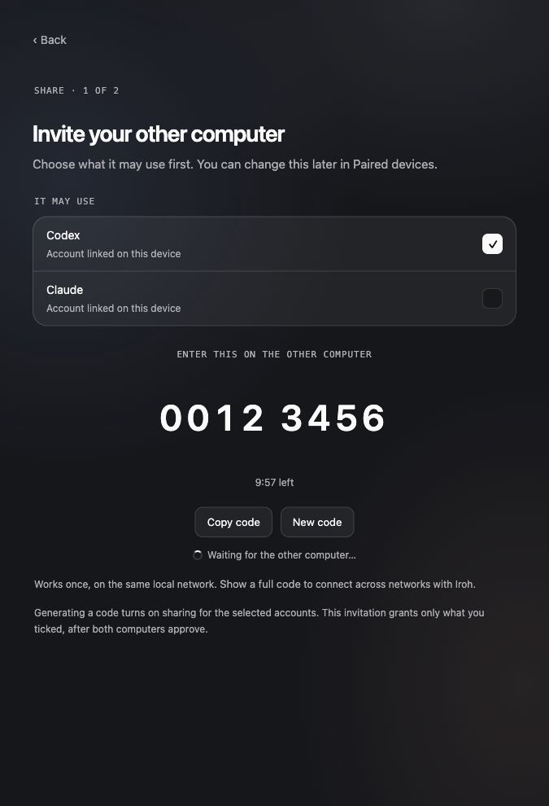
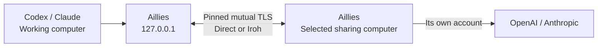
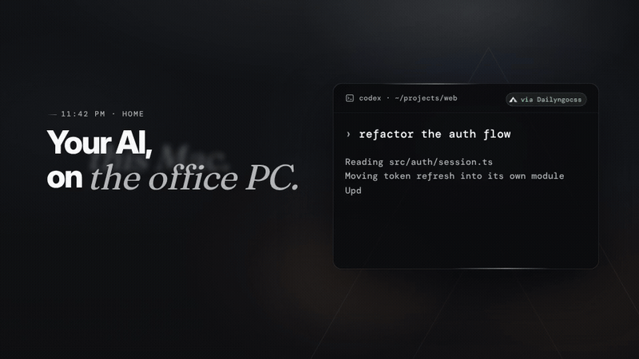

<p align="center">
  
</p>
<h1 align="center">Aillies</h1>
<p align="center"><strong>Your AI. Across computers you trust.</strong></p>
<p align="center">Use Codex or Claude through a paired computer.<br>The account’s login stays on the computer that owns it.</p>
<p align="center">
  <a href="https://github.com/aa-matthew/Aillies/releases/latest"></a>
  <a href="https://github.com/aa-matthew/Aillies/actions/workflows/ci.yml"></a>
  
  <a href="docs/CLAUDE.md"></a>
</p>
<p align="center">
  <a href="#download">Download</a> · <a href="#get-connected">Get connected</a> · <a href="#inside-the-app">App preview</a> · <a href="docs/README.md">Documentation</a>
</p>



## Download

**1.1.2 is the latest release**, published October 15, 2026. It adds sender-side Claude effort defaults, clearer diagnostics, prominent internet pairing codes and Windows startup repairs.

| Desktop app | Latest · **1.1.2** | Previous · **1.1.1** |
| --- | --- | --- |
| macOS 13+ · Apple Silicon | [Download DMG](https://github.com/aa-matthew/Aillies/releases/download/v1.1.2/Aillies_1.1.2_aarch64.dmg) | [Download DMG](https://github.com/aa-matthew/Aillies/releases/download/v1.1.1/Aillies_1.1.1_aarch64.dmg) |
| Windows · x64 | [Download installer](https://github.com/aa-matthew/Aillies/releases/download/v1.1.2/Aillies_1.1.2_x64-setup.exe) | [Download installer](https://github.com/aa-matthew/Aillies/releases/download/v1.1.1/Aillies_1.1.1_x64-setup.exe) |
| Linux · x64 | [DEB](https://github.com/aa-matthew/Aillies/releases/download/v1.1.2/Aillies_1.1.2_amd64.deb) · [AppImage](https://github.com/aa-matthew/Aillies/releases/download/v1.1.2/Aillies_1.1.2_amd64.AppImage) | [DEB](https://github.com/aa-matthew/Aillies/releases/download/v1.1.1/Aillies_1.1.1_amd64.deb) · [AppImage](https://github.com/aa-matthew/Aillies/releases/download/v1.1.1/Aillies_1.1.1_amd64.AppImage) |
| Release notes, CLI & source | [1.1.2 assets](https://github.com/aa-matthew/Aillies/releases/tag/v1.1.2) · [Checksums](https://github.com/aa-matthew/Aillies/releases/download/v1.1.2/SHA256SUMS) | [1.1.1 assets](https://github.com/aa-matthew/Aillies/releases/tag/v1.1.1) · [Checksums](https://github.com/aa-matthew/Aillies/releases/download/v1.1.1/SHA256SUMS) |

Mac packages are ad-hoc signed and **not notarized**; Windows installers are **unsigned**. Intel Mac users can use the CLI archive on the release page. Use the same current version on both computers for Iroh pairing. [All release details →](docs/RELEASES.md)

## Get connected

1. **Share:** Open Aillies on the computer with the account. Enable Codex sharing, or connect a Claude account and enable sharing. Choose what the invitation allows.
2. **Pair:** On your working computer, choose **Use another computer’s account**. Enter the eight-digit code on the same local network, or paste a full code to connect across networks with Iroh. Compare the verification code and approve on both computers.
3. **Activate:** Choose a device for Codex or Claude and turn on its Aillies toggle. On Mac, review the affected clients; Aillies quits them, switches routing and reopens desktop apps only. Windows/Linux guide you through closing and reopening manually.

You can use and share independently, route each service through a different paired device, or select **This device** to use your own account. Terminal sessions and editors are never reopened automatically.

## Inside the app

<table>
  <tr>
    <td width="33%"></td>
    <td width="33%"></td>
    <td width="33%"></td>
  </tr>
  <tr>
    <td align="center"><strong>Choose your role</strong></td>
    <td align="center"><strong>Use here. Share there.</strong></td>
    <td align="center"><strong>Approve the connection</strong></td>
  </tr>
</table>

*Current app previews use synthetic devices, accounts and pairing codes. Click an image to inspect it.*

| You control | How it works |
| --- | --- |
| **Use** | Independent Codex/Claude activation and a device picker for each service. |
| **Share** | Local account status, separate sharing switches and **Allow Fast mode** while Codex sharing is on. |
| **Pairing & access** | One-time invitations, approval on both computers, per-device service permissions and revocation. |
| **Your device** | Editable name, version and Diagnostics in Connection details. |
| **Recovery** | Four recent warnings; the latest 100 records per diagnostic log, with export. No prompts, outputs or tokens. |
| **Exit** | **Disconnect & quit** removes Aillies-owned settings and preserves other edits. If cleanup needs attention, review the result and choose **Quit anyway**. |

## The login stays home



The sharing computer sends credentials only to its provider. Account tokens never cross the peer connection. Peers are identified by certificate fingerprint, and permissions are checked for every request.

Aillies can retry a failed request up to **three times after the first attempt**, on the same device, account and model. It buffers generation events until an attempt completes. Cancellation, account/route changes and permission or validation refusals stop retries; there is no account or device fallback. Failed attempts may consume usage.

Connected Claude tokens are saved atomically in Aillies’ private app-data folder with user-only permissions. File storage offers less protection than Keychain. Older Keychain connections require an explicit reconnect; Aillies does not silently transfer them. [Architecture →](docs/ARCHITECTURE.md) · [Security →](SECURITY.md)

## Launch storyboard

[](assets/readme/launch-storyboard.mp4)

[View the 8-second storyboard preview](assets/readme/launch-storyboard.mp4) · [Media sources](assets/readme/README.md)

*Reuses frames from the existing launch film; this is a silent storyboard preview, not a new motion-film render. The current product UI is shown above.*

## Release status

| Area | Current status |
| --- | --- |
| **Codex** | Released in 1.1.1: local/paired routing, sharing, model handling, Fast permission and safe per-chat provider migration. Damaged or unsupported histories are preserved and reported. |
| **Claude** | **Experimental** Claude Code and desktop Chat routing, explicit OAuth connection, refresh, model discovery and reviewed request adaptation. Account connection runs on macOS; Windows/Linux can use a paired Mac. |
| **Connectivity** | Nearby eight-digit pairing and Iroh full codes are implemented. Current public relay readiness was probed; physical cross-network behavior still needs device-specific acceptance. |
| **Verification** | 1.1.1 release CI passed on macOS, Windows and Linux. Local checks passed 231 default Rust cases, UI contracts, release checks, strict lint and isolated Codex mock smoke. |
| **Still to validate** | Current native image generation, live account entitlement/usage, physical permission dialogs and interrupted-request behavior. Signing/notarization and auto-updates remain planned. |

The official **ChatGPT desktop app cannot use another device’s account**. Aillies routes Codex through its Responses provider configuration. Current automated upstream checks use mocks; they do not establish live provider acceptance. [Detailed acceptance status →](docs/STATUS.md)

## For developers

Rust 2021 · Tauri 2 · plain HTML/CSS/JS. The desktop app and headless CLI share the same node and protocol. Run either the desktop app or `aillies run`, since they use the same loopback port.

```sh
cargo install --path crates/aillies-cli --locked
make test
make lint
make smoke
```

<details>
<summary><strong>Headless two-computer setup</strong></summary>

Start `aillies run` on both computers. In another terminal on the account-owning computer:

```sh
aillies invite            # nearby eight-digit code
# or: aillies invite --full
```

On the working computer:

```sh
aillies pair '1234 5678'   # or paste the full code; compare and approve on both
aillies codex on
```

Quit and reopen Codex. To return to its normal provider, use `aillies codex off`. For desktop source builds on macOS, see `scripts/install-macos.sh` or the [development guide](docs/DEVELOPMENT.md).

</details>

| Guide | What you’ll find |
| --- | --- |
| [Documentation index](docs/README.md) | Setup, troubleshooting and reference guides |
| [Claude setup](docs/CLAUDE.md) | Connect account, supported clients and experimental limits |
| [Features](docs/FEATURES.md) | Current behavior and implementation locations |
| [Architecture](docs/ARCHITECTURE.md) | Routing, credentials, transport and state |
| [Development](docs/DEVELOPMENT.md) · [Contributing](CONTRIBUTING.md) | Build, checks and release workflow |
| [Changelog](CHANGELOG.md) · [Releases](docs/RELEASES.md) | What changed and which artifacts to download |

© 2026 Anyaxis Labs. All rights reserved. See [LICENSE](LICENSE).
